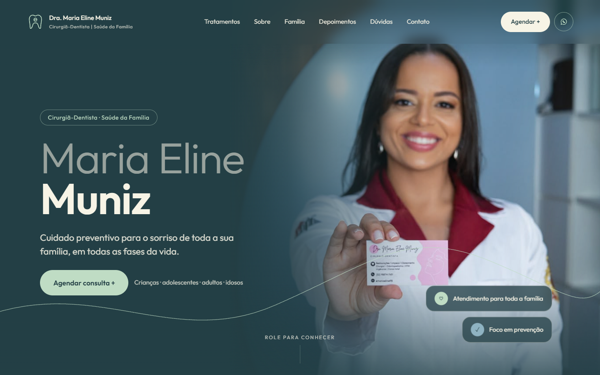

# Site da Dra. Maria Eline Muniz

Site institucional de uma página (landing page) da cirurgiã-dentista Maria Eline Muniz (Juiz de Fora, MG), com atendimento particular. O objetivo é apresentar a profissional, os tratamentos e o consultório, e levar a pessoa a agendar pelo WhatsApp.

Publicado em <https://dramariaeline.pages.dev>.




## Stack

| Área       | Escolha                                                                         |
| ---------- | ------------------------------------------------------------------------------- |
| Framework  | Next.js 16 (App Router), exportado como site estático (`output: "export"`)      |
| Linguagem  | TypeScript estrito (`any` proibido pelo ESLint)                                 |
| Estilo     | Tailwind CSS 4, com tokens em `src/styles/`                                     |
| Validação  | Zod (dados de contato)                                                          |
| Testes     | Vitest (unitários e de componentes) e Playwright (navegador, com `axe`)         |
| Qualidade  | ESLint, Prettier, gitleaks e GitHub Actions                                     |
| Hospedagem | Cloudflare Pages (plano gratuito), publicação automática a cada merge na `main` |

Não há back-end nem banco de dados: todo o conteúdo é versionado no repositório.

## Como rodar

Requer Node 22 ou superior.

```bash
npm install
npm run dev          # servidor de desenvolvimento em http://localhost:3000
```

| Comando                  | O que faz                                                             |
| ------------------------ | --------------------------------------------------------------------- |
| `npm run lint`           | ESLint                                                                |
| `npm run typecheck`      | Gera os tipos do Next e roda o `tsc`                                  |
| `npm run format:check`   | Confere a formatação (Prettier); `npm run format` corrige             |
| `npm test`               | Testes unitários (Vitest)                                             |
| `npm run test:cobertura` | Testes com cobertura da lógica (`lib` e `content`), mínimo de 90%     |
| `npm run build`          | Gera o site estático na pasta `out/`                                  |
| `npm run test:e2e`       | Testes de navegador (Playwright) sobre o `out/`; rode o `build` antes |

Para o Playwright pela primeira vez: `npx playwright install chromium`.

### Variável de ambiente

`NEXT_PUBLIC_SITE_URL` (opcional) define o endereço público, sem barra no final. Ela alimenta o link canônico, o Open Graph, os dados estruturados, o `robots.txt` e o `sitemap.xml`. Em desenvolvimento pode ficar vazia. Veja `.env.example`.

## Estrutura

```
app/                 Página e layout do Next.js, robots e sitemap. Sem regra de negócio.
src/
  components/
    secoes/<nome>/   Cada seção do site. Tem a versão para telas grandes (Sobre.tsx)
                     e a versão para telas menores que 1180 px (SobreCompacta.tsx).
    layout/          Cabeçalho e rodapé.
    ui/              Peças reutilizáveis (logo, ícones, cabeçalho de seção...).
    comportamento/   Componentes só de comportamento, sem visual: navegação entre
                     seções, animações ao rolar, paralaxe.
    seo/             Dados estruturados (schema.org).
  content/           Conteúdo do site como objetos tipados: textos, tratamentos,
                     contatos (validados com Zod).
  lib/               Funções puras: formatação, links do WhatsApp e do mapa, SEO, URL.
  styles/            Tokens de cor, fonte e espaço, e as animações.
public/images/       Imagens otimizadas (WebP).
tests/
  unit/              Vitest. Espelha content/ e lib/.
  componentes/       Vitest + Testing Library. Menu, links e animação ao rolar.
  e2e/               Playwright. Um arquivo por assunto.
scripts/             Preparo das imagens (corte e otimização) a partir dos originais.
docs/                PRD, plano, registro de decisões e referência de design.
```

A direção das dependências é `app → components → content/lib`. `content` e `lib` nunca importam componentes nem a pasta `app`. Todos os nomes são em português, exceto os que o framework impõe.

As seções com duas versões (`Sobre.tsx` e `SobreCompacta.tsx`) dividem as peças iguais em `components/ui/` (por exemplo `ParagrafoComDestaque` e `LinkExterno`); só o layout muda entre elas. O breakpoint `largo:` (1180 px) é o que troca de uma versão para a outra.

### Decisões de projeto que valem saber

- **Conteúdo fora dos componentes.** Textos, serviços e contatos ficam em `src/content/` como objetos tipados. Os componentes só apresentam. Isso permite testar o conteúdo (por exemplo, que os tratamentos batem com o PRD) sem renderizar nada.
- **Duas versões de cada seção.** O design do celular é outro layout, não só uma versão menor do desktop. Por isso cada seção tem um componente para telas pequenas (`*Compacta.tsx`) e outro para telas grandes, e o CSS mostra um ou outro no ponto de quebra de 1180 px. O padrão fica num só lugar, o componente `SecaoPagina`. O conteúdo vem da mesma fonte, então os textos não se duplicam à mão.
- **Medidas repetidas viram utilitários.** Espaço interno das seções, título e rótulo ficam em `src/styles/secoes.css`; a altura do cabeçalho é uma variável CSS (`--altura-cabecalho`) lida também pelo JavaScript, e um teste confere que o valor bate com a altura real.
- **Lógica separada do navegador.** A conta de onde a página para ao clicar no menu é uma função pura (`src/lib/posicaoDaSecao.ts`), testada sem abrir navegador; o componente só mede a página e entrega as medidas.
- **Animações em CSS, ativadas ao entrar na tela.** Um observador marca cada bloco que aparece e o CSS faz o resto. Sem JavaScript, ou com "reduzir movimento" ligado no sistema, nada fica escondido.
- **Site estático.** Gera HTML puro, sem servidor, o que mantém o custo zero e o carregamento rápido.
- **Acessibilidade e desempenho** são verificados nos testes (axe, teclado, imagens com texto alternativo) e nas métricas do Lighthouse.

## Desenvolvimento com IA

O código foi escrito em pares com o Claude Code, seguindo as regras de [`CLAUDE.md`](CLAUDE.md). Cada mudança entra por pull request, com CI verde e revisão humana antes do merge. As escolhas técnicas e o motivo de cada uma ficam em [`docs/DECISOES.md`](docs/DECISOES.md).

## Fluxo de trabalho

1. Branch a partir da `main` atualizada (`tipo/N-descricao`).
2. Commits pequenos no formato `tipo: descrição (#N)`.
3. Pull request com o que foi feito, as escolhas técnicas e como testar. O CI roda lint, tipos, formatação, testes, build e a varredura de segredos.
4. Revisão humana e merge com squash. A `main` é protegida: não aceita push direto.

## Documentação

- [`docs/prd.md`](docs/prd.md): requisitos e textos oficiais.
- [`docs/PLANO.md`](docs/PLANO.md): etapas e o que já foi feito.
- [`docs/DECISOES.md`](docs/DECISOES.md): registro de cada decisão e por quê.
- [`CLAUDE.md`](CLAUDE.md): regras do projeto para quem desenvolve com o Claude Code.

## Observação sobre o conteúdo

O texto do site segue o PRD. Depoimentos e imagens de pacientes só são publicados com o termo de consentimento de cada pessoa, e a publicidade segue as regras do Conselho Federal de Odontologia (ver `docs/DECISOES.md`, D22 e D23).
